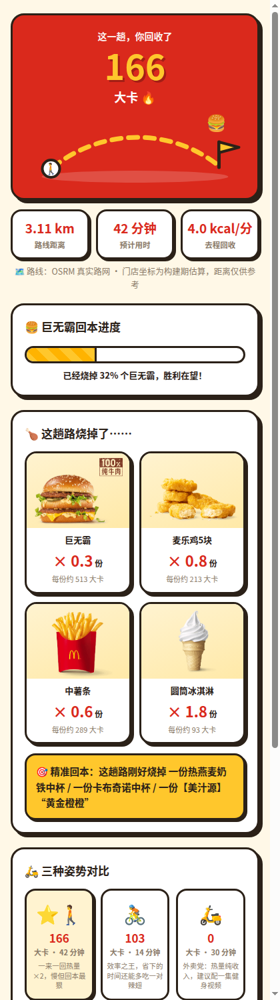

# 🍔 麦麦热量回收计划（MaiMai Calorie Recycle）

> 去麦当劳这趟路，烧掉的卡路里都是你回收的额度。
> 别人算热量是怕吃，我们算热量是给吃找理由。

**麦当劳程序员创意开发大赛参赛作品** · 基于麦当劳中国 MCP Server · 非麦当劳官方产品

 

## 这是什么？

一个手机网页 + Agent Skill：输入你的位置，找到最近的麦当劳，按**真实步行/骑行路线**算出这趟路消耗的卡路里，再用**麦当劳官方营养数据**告诉你——

> 这一趟，你回收了 **2.3 块麦乐鸡** 🔥 还是 **0.3 个巨无霸**？

- 🚶 步行去？回收翻倍，还能心安理得啃个巨无霸
- 🚴 骑行去？效率之王，省下的时间多吃一对辣翅
- 🛵 点外卖？热量纯收入，建议配一集健身视频

## 30 秒上手

| 方式 | 操作 |
|---|---|
| **在线体验** | 打开 GitHub Pages：`https://dolkkk.github.io/mcd-calorie-recycle/`（手机浏览器体验最佳） |
| **本地运行** | `git clone` 后直接双击 `index.html`——零依赖、零构建、零配置 |
| **AI 助手形态** | 把 `skills/mcd-calorie-recycle/SKILL.md` 装进支持 Agent Skill 的助手（需连接麦当劳 MCP） |

网页运行期**不调用 MCP、不需要 Token**：门店/营养/图片数据在构建期用官方 MCP 抓取后打包进 `data.js`，普通用户零配置即用，凭证永不暴露在前端（详见 [MCP_INTEGRATION.md](MCP_INTEGRATION.md)）。

## 玩法

1. **选出行方式**：步行 / 骑行
2. **定位**：浏览器定位（坐标不出设备）或手动选地标；自动列出最近 5 家麦当劳
3. **拖体重滑条** → 点「🔥 算算这趟回收多少」
4. 收获：真实路线距离/用时、卡路里大数字、**巨无霸回本进度条**、明星餐品回收清单（带官方图）、"精准回本榜"彩蛋、三姿势热量对比、一键复制战报

## 计算口径（诚实说明）

| 项 | 做法 |
|---|---|
| 路线 | OSRM（OpenStreetMap）真实路网，步行/骑行 profile；断网时回退「直线距离 × 1.35 绕路系数」 |
| 热量 | ACSM MET 公式：`kcal = MET × 3.5 × 体重kg ÷ 200 × 时长分钟`；步行 3.8 MET、休闲骑行 5.0 MET |
| 口径 | **总消耗**（含静息代谢），与主流运动 App 的"活动消耗"展示习惯一致；净消耗可按 `(MET−1)` 项自行换算 |
| 营养 | 160 项餐品能量/蛋白/脂肪/碳水全部来自 `list-nutrition-foods` 官方返回，未做修改 |
| 图片 | 110 项餐品官方图（`menu-img.mcd.cn`），其余为占位图卡 |
| 门店 | 名称/地址/营业时间来自 `query-nearby-stores`；坐标为构建期开源地图估算，距离仅供参考 |

> MET 参数与单位口径经腾讯 WorkBuddy 算法审查校准，采纳记录见 [workbuddy.md](workbuddy.md)。

## 架构

```
构建期（tools/，需 MCP Token）              运行期（浏览器，零 Token）
┌────────────────────────┐               ┌─────────────────────────┐
│ mcd_pipeline.py        │               │ index.html（单文件）      │
│  ├ list-nutrition-foods│   data.js     │  ├ 浏览器定位 / 地标兜底  │
│  ├ query-nearby-stores │ ────────────▶ │  ├ 最近门店匹配           │
│  └ query-meals（图片）  │   打包内联     │  ├ OSRM 步行/骑行路线     │
│ geocode_stores.py      │               │  ├ MET 热量 + 餐品换算    │
│  └ Photon/OSM 坐标补全  │               │  └ 卡通 UI + 图片展示     │
│ build_web_data.py      │               └─────────────────────────┘
└────────────────────────┘
```

```
├── index.html                  # 手机网页（零依赖单文件）
├── data.js                     # 构建期数据包（营养/门店/图库）
├── README.md / CONTEST_DECLARATION.md / MCP_INTEGRATION.md / workbuddy.md
├── mcp-config.example.json     # 脱敏配置（仅环境变量占位符）
├── skills/mcd-calorie-recycle/SKILL.md   # Agent Skill
├── tools/                      # 构建期数据管道
└── images/                     # 截图
```

## 目标用户

- 想吃麦当劳又想找点"理由"的普通人（放心，理由管够）
- 步行/骑行通勤路上顺路去麦的上班族
- 想直观理解食物热量的轻健康人群
- Agent/Skill 玩家（可直接接入 AI 助手）

## 合规与声明

- 本项目为**麦当劳程序员创意开发大赛参赛作品**，由参赛者独立开发，**非麦当劳官方产品**。
- 项目输出仅供参考，**不构成医疗、营养或其他专业建议**；热量为估算值，餐品信息、价格及供应状态以麦当劳官方渠道实时结果为准。
- 餐品营养数据与门店信息来自麦当劳中国 MCP Server 官方接口；路线由 OpenStreetMap / OSRM 计算。
- 麦当劳品牌、产品名称及图片的权利归其权利人所有；本项目仅作大赛展示与学习交流用途。
- 使用麦当劳 MCP 服务须遵守其《使用条款》与《麦当劳 MCP 服务规则》。
- 参赛声明原文见 [CONTEST_DECLARATION.md](CONTEST_DECLARATION.md)。
